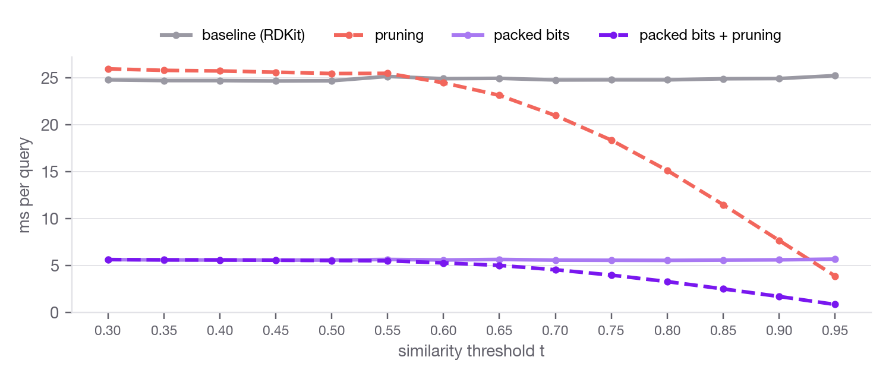

# When pruning doesn't pay: exact similarity search on 250k molecules

Benchmark of four ways to run **exact Tanimoto similarity search** over 248,455 drug-like molecules (ZINC subset, 2,048-bit Morgan fingerprints). All four return identical hits and scores; they differ only in speed.

**Interactive version:** https://min-star-code.github.io/fingerprint-search-pruning/
**Written report (PDF):** [report/Fingerprint_Search_Report.pdf](report/Fingerprint_Search_Report.pdf)



## Findings

Mean time per query, 100 held-out queries, best of 3 runs, one CPU thread (Apple M5):

| threshold t | RDKit baseline | + popcount pruning | packed bits (NumPy) | packed + pruning |
|---|---|---|---|---|
| 0.60 | 24.9 ms | 24.5 ms (1.0×) | 5.6 ms (4.4×) | 5.3 ms (4.7×) |
| 0.95 | 25.2 ms | 3.9 ms (6.5×) | 5.7 ms (4.4×) | 0.87 ms (29×) |

- **The pruning bound** (Swamidass & Baldi, 2007) is exact, but drug-like molecules have similar fingerprint sizes, so at typical thresholds it still has to score 94% or more of the library. It only pays off near t = 0.8 and above.
- **Packed 64-bit words with hardware popcount** are 4.4× faster than RDKit's bulk call at every threshold.
- **The two stack** for near-duplicate search: 29× at t = 0.95.
- **Side finding:** the same RDKit call took 94 ms instead of 21 ms when fingerprint objects were scattered in memory (list order ≠ allocation order), consistent with Dalke (2019) that exact search is memory-bound. All RDKit timings above use contiguous copies, so the baseline is at its best.
- **Correctness:** 0 mismatches in 4,200 method/query/threshold comparisons (indices and float scores compared exactly), plus 30 unit tests against a plain Python loop.

## Layout

```
src/fpsearch.py        four search methods + popcount window
src/benchmark.py       benchmark -> results/benchmark.json
tests/                 pytest: every method vs a slow reference implementation
site/template.html     interactive page (data inlined by site/build.py -> docs/index.html)
report/build_report.py PDF report from the same JSON
data/README.md         how to download the dataset (not redistributed here)
```

## Reproduce

```bash
python3 -m venv .venv && .venv/bin/pip install -r requirements.txt
curl -L -o data/zinc250k.csv https://raw.githubusercontent.com/aspuru-guzik-group/chemical_vae/master/models/zinc_properties/250k_rndm_zinc_drugs_clean_3.csv
.venv/bin/python -m pytest -q tests
.venv/bin/python src/benchmark.py        # ~5 minutes
python3 site/build.py && .venv/bin/python report/build_report.py
```

Timings depend on the machine; correctness checks do not.

## How it was built

Prototyped with a coding agent (Claude Code). I chose the question, the comparisons and the correctness criteria; the agent drafted the code; no number was reported until it matched the reference implementation.

## References

- Bajusz, Rácz & Héberger (2015). Why is Tanimoto index an appropriate choice for fingerprint-based similarity calculations? *J. Cheminform.* 7, 20.
- Dalke (2019). The chemfp project. *J. Cheminform.* 11, 76.
- Gómez-Bombarelli et al. (2018). Automatic chemical design using a data-driven continuous representation of molecules. *ACS Cent. Sci.* 4(2), 268–276.
- Rogers & Hahn (2010). Extended-connectivity fingerprints. *J. Chem. Inf. Model.* 50(5), 742–754.
- Swamidass & Baldi (2007). Bounds and algorithms for fast exact searches of chemical fingerprints in linear and sublinear time. *J. Chem. Inf. Model.* 47(2), 302–317.

Independent project; not affiliated with any company.
